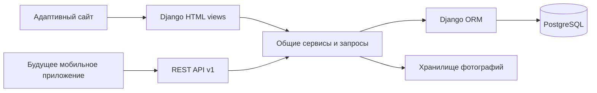
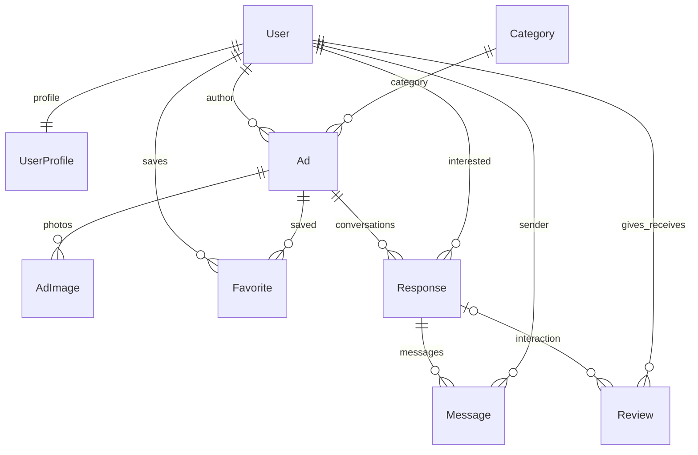

# Архитектура ДоскаСВФУ

## Назначение

Университетский маркетплейс для объявлений о вещах, услугах и поиске соседей.
Одна серверная система обслуживает адаптивный сайт и API будущего мобильного приложения.

## Принятые решения

1. **Модульный монолит Django.** Простое размещение, транзакции в одной БД,
   встроенная административная панель. Пока модели остаются в существующем `ads`,
   чтобы сохранить историю миграций. Разделение приложения на пакеты по предметным
   областям можно выполнить позднее; перенос моделей между Django apps требует миграций.
2. **Два адаптера к общей предметной логике.** `views.py` обслуживает HTML,
   `api/` — JSON. `services.py` содержит операции записи и проверки бизнес-правил,
   `selectors.py` — общие запросы. Проверки не зависят от наличия кнопки в интерфейсе.
3. **Аутентификация.** Сессии + CSRF для сайта. JWT access (15 минут) и refresh
   (7 дней) для мобильного клиента; refresh ротируется, старый помещается в blacklist.
   Выход отзывает refresh. Уже выданный access действует до истечения срока.
4. **Интерфейс.** Django Templates, собранный Tailwind CSS и собственная таблица стилей.
   Небольшой обычный JavaScript отвечает за избранное, галерею, превью загрузок
   и опрос новых сообщений. HTMX сейчас не добавлен: текущие взаимодействия
   используют API, который пригодится мобильному приложению.
5. **Хранение.** SQLite для быстрого локального запуска, PostgreSQL для итогового
   размещения; фото хранятся отдельно от строк БД. На сервере рекомендуется S3-совместимое хранилище.

## Предметная модель

С ноября 2026 модуль `campus` расширяет предметную модель учебными запросами,
местами кампуса, объяснимым подбором и двусторонними встречами с бронью и возвратом.
Схема, формула ранжирования, состояния и API описаны в [campus-exchange.md](campus-exchange.md).

`Ad.image` — обложка (сохранено прежнее поле), `AdImage` — дополнительные фото.
Их суммарное количество через сайт/API ограничено восемью. `Response` — один диалог
между автором объявления и заинтересовавшимся пользователем. Исторические `text/reply`
сохранены для совместимости; новые сообщения записываются в `Message`.

Категории защищены от удаления при наличии объявлений (`PROTECT`). Удаление объявления
каскадно удаляет избранное и диалоги. Связь отзыва с удалённым диалогом становится NULL;
сам отзыв сохраняется. При удалении пользователя связанные с ним отзывы удаляются.
Удаление записи фото не удаляет файл из хранилища: очистка неиспользуемых файлов
планируется отдельно с периодом хранения, чтобы не повредить резервные копии.

## Правила

- Каталог публичен; черновики, закрытые и архивные объявления доступны их автору.
- Менять и удалять объявление может его автор. Администратор обладает отдельными правами.
- Пара `(user, ad)` уникальна для избранного и диалога; API избранного идемпотентен.
- Новый диалог создаётся только по опубликованному чужому объявлению.
- Переписка доступна только двум участникам. Существующий диалог остаётся доступным
  после закрытия объявления, пока объявление не удалено.
- Принять отклик может только автор объявления. Это открывает возможность отзыва
  обоим участникам и не подтверждает совершение сделки.
- Сохранено прежнее правило: один отзыв от одного пользователя другому за всё время.
  Исторические отзывы не требуют связи с диалогом; новые требуют принятого отклика.
- В БД проверяются цена, диапазон оценок, запрет самоотзыва и уникальность связей.
- Телефон профиля скрыт по умолчанию. Его видят вошедшие пользователи по объявлению
  при согласии продавца. Дополнительные контакты объявления также доступны после входа.
- Поле «студент/сотрудник» заполняет пользователь; оно не означает проверку университетом.

## Миграция старого прототипа

Миграция `0010` сначала добавляет схему, затем переносит состояния активности,
создаёт профили, переносит тексты откликов и ответов в сообщения и объединяет
дубликаты диалогов. Старые даты отклика используются для импортированных сообщений,
так как отдельной даты ответа в прототипе не было. Затем применяются ограничения БД.
Исходные файлы фотографий не перемещаются.

Миграция необратима автоматически: разделить объединённые диалоги без исходной
базы нельзя. Для отката нужно восстановить резервную копию БД и предыдущую версию кода.
Перед запуском на другой существующей базе следует проверить отрицательные цены,
самоотзывы и оценки вне 1–5; при таких данных ограничения остановят миграцию.

## Безопасность и ограничения

Сайт использует CSRF, POST для изменений, проверку владельца на сервере,
экранирование шаблонов, валидацию форм и ограничения БД. API разрешает запись
авторизованным пользователям и проверяет доступ к объектам. Django Axes ограничивает
неудачные попытки входа, DRF — частоту запросов. Загрузка принимает только декодируемые
JPEG/PNG/WebP до 5 МБ и 24 Мп; фото перекодируются в JPEG с удалением метаданных.
На reverse proxy следует дополнительно ограничить тело запроса и частоту обращений.

Опрос сообщений происходит раз в 6 секунд только на открытой вкладке диалога.
Это не WebSocket и не фоновые push-уведомления. Ограничители DRF используют локальный
cache по умолчанию и не являются общей защитой нескольких процессов: для масштабирования
нужны общий Redis cache и ограничения reverse proxy. Отдельные проверки
текста описаний на спам и модерация пока не реализованы.

## Что можно описать в ВКР

1. Предметная область, аудитория, аналоги и функциональные требования.
2. Выбор стека и сравнение монолита с отдельным frontend/API.
3. Диаграмма сущностей, связи, нормализация и ограничения целостности.
4. Сценарии авторизации, публикации, диалога, избранного и отзыва.
5. Организация доступа, обработка файлов и защита персональных контактов.
6. Интерфейс, адаптивность и доступность.
7. Интеграционное тестирование и реальные результаты проверок.
8. Размещение, резервное копирование и развитие мобильного клиента.

Это архитектурная основа пояснительной записки, а не готовый текст ВКР по требованиям кафедры.

## Экран переписки (30 октября 2026)

HTML-маршруты `/messages/` и `/messages/<id>/` используют общий компонент
`templates/components/messenger.html`. Слева находятся приватные разговоры с
последним сообщением и количеством непрочитанных, справа — выбранная переписка.
Поиск по собеседнику/объявлению и фильтр непрочитанных работают в браузере.
На телефоне отображается один экран за раз: список или выбранный разговор.

`ads/selectors.py::conversations` ограничивает выборку участниками и получает
превью/непрочитанные подзапросами, без отдельного запроса на каждую строку списка.
`/messages/sidebar/` возвращает только собственные разговоры. Ответы сообщений
не кешируются; HTML-фрагменты дополнительно различаются заголовком
`X-Messenger-Request`. Проверка доступа сохраняется для полных и частичных страниц.

`messenger.js` улучшает обычные ссылки и формы: разговор переключается без полной
перезагрузки, сообщение отправляется существующим API с CSRF. Серверные формы
остаются рабочими при отключённом JavaScript. Новые сообщения и превью проверяются
каждые 6 секунд, только когда вкладка видима. Это обычный опрос API; WebSocket и
статус онлайн пока не реализованы. Тексты сообщений вставляются через `textContent`.

Черновики хранятся только в памяти текущей страницы, отдельно для каждого разговора;
переживают переключение чатов, но исчезают при обновлении или закрытии страницы.
Сетевой сбой не очищает поле. Параллельная отправка и получение сообщений не меняют
их порядок. Переходы поддерживают историю браузера и отменяют устаревшие запросы.

Страница объявления использует тот же сервис создания разговора. При существующем
диалоге показывает ссылку продолжения; ошибка валидации оставляет введённый текст.
Быстрые вопросы только заполняют поле: отправка остаётся явным действием пользователя.
Просмотр фото использует нативный `dialog` с закрытием кнопкой и клавишей Escape.

Подсистема поддержки вынесена в отдельное приложение `support/`. Модели,
переходы статусов, права оператора и API описаны в [support.md](support.md).
Панель управления расширяет штатный Django Admin через `config/admin_site.py`.

## Фотографии и предпочтения интерфейса

Загрузчик в `photo-editor.js` хранит отдельные подборки `File` для обложки и других
фото в памяти страницы. Выбор порциями не зависит от изменения нативного `FileList`:
собранные файлы передаются непосредственно в `FormData`. Временные URL освобождаются.
POST с `Accept: application/json` использует ту же форму и сервис сохранения, что и
обычный HTML. Успех возвращает URL объявления, ошибка — JSON с полями/сообщениями и
статусом 400. Клиент показывает ошибки через `textContent`, сохраняя подборку и текст;
защита CSRF остаётся включённой. Обычные формы без JavaScript продолжают работать.
Клиентские ограничения дублируются серверной проверкой содержимого изображений.
`AdForm.delete_photos` принимает только фотографии редактируемого объявления.
Сервис `save_ad` проверяет принадлежность, итоговый лимит и удаляет выбранные записи
в той же транзакции, где сохраняет объявление. Новые позиции идут после оставшихся.
Общий лимит применяется также в административном inline-formset.

Галерея использует нативный `dialog` с управлением фокусом и прокруткой. Центральная
ячейка задаётся явно, чтобы скрытие стрелок у одиночного фото не уменьшало изображение.
Высота окна учитывает пропорции снимка; зум 2× и перемещение работают внутри окна.
`UserProfile.reduce_motion` хранит предпочтение аккаунта; HTML и личный API используют
одно поле. Системный `prefers-reduced-motion` также учитывается. Публичные профили
не раскрывают настройки интерфейса или скрытые контакты.

Административные страницы используют общий `campus_sidebar.html`, построенный на
штатном списке моделей с проверкой прав. `WorkspaceAdminMixin` меняет только заголовки
списков; поиск, фильтры, действия и защита Django Admin продолжают работать штатно.
