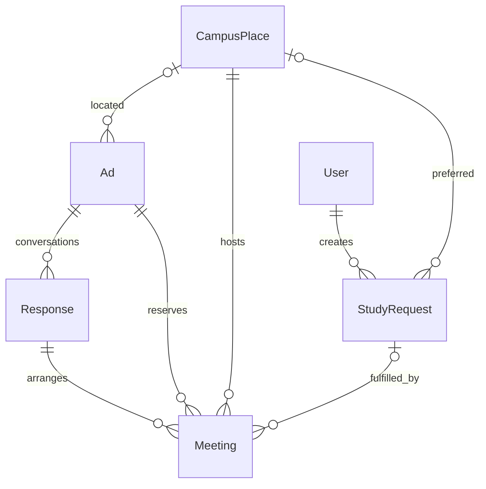
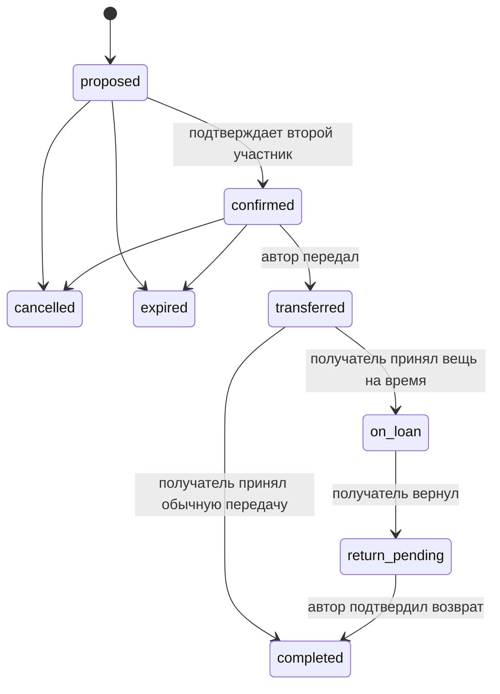

# Учебный обмен «Передай следующему курсу»

## Назначение и вклад в ВКР

Модуль связывает три студенческих сценария: поиск учебной вещи по предмету,
объяснимый подбор предложений и согласование передачи между занятиями. Студент
может продать, обменять, отдать или бесплатно одолжить вещь; получатель может
оставить запрос «Мне нужно». Временная передача имеет согласованную дату возврата.

Предметный вклад проекта — сочетание учебного запроса, правил ранжирования и
двустороннего жизненного цикла передачи. Не заявляется мировая уникальность
отдельных функций. Количественную пользу для пользователей ещё предстоит оценить
на пользовательских испытаниях: время поиска, доля релевантных совпадений, доля
согласованных встреч и завершённых передач.

## Данные и структура

- `campus/models.py`: `CampusPlace`, `StudyRequest`, `Meeting`.
- `campus/selectors.py`: отбор доступных учебных предложений и ранжирование.
- `campus/services.py`: создание встреч, переходы состояний и отклик на запрос.
- `campus/forms.py`, `views.py`: формы и HTML; `campus/api.py`: REST API.
- `templates/campus/`: лента, запрос, совпадения и карточка встречи в разговоре.
- `ads/static/ads/{css,js}/campus.*`: оформление и необязательные улучшения.

В существующую `Ad` добавлены: `is_study`, `subject`, `course` (1–6), `semester`
(1–12), `campus_place`, `available_from`, `available_until`, `exchange_for`.
Типы `give`, `exchange`, `lend` нормализуются к нулевой цене. Они не обозначают
платную аренду; возвратность определяется `lend`, а не ценой.

`CampusPlace`: название, ориентир и доступность выбора. Это справочник, а не
карта расстояний или подтверждённое университетом безопасное место. Начальные
значения — общие «Библиотека», «Учебный корпус», «Студенческий городок»; конкретные
корпуса и ориентиры сотрудник может настроить в админке. Удаление используемого
места запрещено через `PROTECT`; вместо удаления его можно отключить.

`StudyRequest`: автор, название, предмет, необязательные курс и семестр,
желаемый способ получения, описание, место, интервал и состояние поиска.
Открытые запросы публичны; закрытые доступны автору. Подробности и указанный
интервал публикуются сознательно через форму. Менять запрос может только автор.

`Meeting`: разговор, объявление, инициатор, место, начало и конец встречи,
необязательный запрос получателя, дата возврата, снимок признака временной
передачи, состояние и даты создания/изменения. Снимок `is_loan` сохраняет правила
уже согласованной передачи независимо от дальнейшей жизни объявления.



Связь `Meeting.ad` дублирует объявление разговора намеренно: так частичное
уникальное ограничение БД запрещает две действующие брони одного объявления
в разных разговорах. Сервис всегда выводит эту связь из разговора, клиент её
не задаёт. Второе частичное ограничение разрешает только одно незавершённое
предложение встречи в одном разговоре.

## Формула подбора

Сначала исключаются чужие закрытые объявления, предложения самого заявителя,
неучебные объявления, запросы покупки/соседа, неподходящий способ передачи,
занятые вещи и предложения с истекшим интервалом получения. Предметы сравниваются
после Unicode NFKC, `casefold`, замены «ё» на «е» и удаления пунктуации.

| Совпадение | Баллы |
|---|---:|
| Полностью одинаковый нормализованный предмет | 60 |
| Либо пересечение значимых слов / максимум числа слов ≥ 0,5 | 40 |
| Тот же указанный курс | +15 |
| Тот же указанный семестр | +10 |
| То же выбранное место | +10 |
| Пересекаются ещё не истекшие интервалы встречи | +5 |

Максимум — 100; пропущенные условия баллов не дают. Союзы и предлоги не
участвуют в пересечении слов. Если предмет не совпал ни одним способом,
предложение не попадает в результаты. При равенстве баллов первыми идут более
новые ID. Возвращаются первые 24 результата с перечнем причин. Балл не является
вероятностью, оценкой качества вещи или репутацией автора.

В первой версии сравнение всех подходящих предложений выполняется в Python за
O(n); это обеспечивает корректное сравнение кириллицы и в SQLite. Скрытого лимита
кандидатов нет. Для большого каталога потребуется вынести поиск кандидатов в
индексируемый нормализованный справочник предметов / PostgreSQL; текущая версия
не распознаёт автоматически аббревиатуры и синонимы вроде «матан» и «матанализ».
Новых совпадений по email/push нет: они вычисляются при открытии страницы или API.

## Встреча и бронь

1. Любой участник разговора предлагает активное место и будущий интервал:
   до 4 часов, не позднее чем через 30 дней. Если автор указал доступность в
   объявлении, встреча должна целиком в неё попадать.
2. Второй участник подтверждает предложение. Инициатор подтвердить своё
   предложение не может. После подтверждения вещь забронирована до конца интервала.
3. До передачи любой участник может отменить встречу. Если интервал прошёл,
   неотмеченная передача считается истекшей, вещь доступна другим пользователям.
4. Начиная с начала встречи автор отмечает передачу. Получатель подтверждает
   получение. Для обычной передачи объявление закрывается, выбранный запрос
   получателя закрывается, обоим участникам открывается существующий механизм отзывов.
5. При `lend` после получения вещь остаётся занятой. Получатель отмечает возврат,
   затем автор подтверждает, что получил вещь обратно. После этого она снова доступна.

Для временной передачи дата возврата обязательна: позже дня встречи, не более
180 дней после неё. Истечение даты не делает переданную вещь доступной автоматически:
появляется отметка просрочки, требуется реальное подтверждение возврата.



Проверки срока на чтении не изменяют БД: UI/API возвращают `effective_status`.
При следующей записи по этому объявлению старые `proposed/confirmed` помечаются
`expired` внутри транзакции. Поэтому отдельный планировщик для освобождения брони
не нужен. Все изменения брони блокируют строку объявления через `select_for_update`;
дополнительную защиту даёт уникальное ограничение БД. SQLite остаётся локальным
режимом с ограниченной конкурентной записью; проверка нескольких процессов
на PostgreSQL в этой итерации не выполнялась.

В активной брони/передаче HTML и API запрещают удаление объявления и смену типа,
статуса, места или интервала. Операционные состояния встреч в админке доступны
для просмотра; ручной обход последовательности передачи через admin не предусмотрен.
Приватные сообщения сотрудников в административный интерфейс не добавлены.

Изменения создают сообщения в разговоре. Карточка встречи опрашивается раз в
15 секунд на видимой вкладке; введённая форма и фокус не заменяются фоновым
обновлением. Вся работа доступна и обычными POST-формами без JavaScript.
Авторизация, CSRF и проверка участника выполняются на сервере.

## Маршруты и мобильный API

HTML: `/campus/`, `?tab=requests`, `?tab=mine`, `/campus/requests/new/`,
`/campus/requests/<id>/`, `/campus/requests/<id>/edit/`. Встреча находится внутри
существующего разговора `/messages/<id>/`.

| REST маршрут | Назначение |
|---|---|
| `GET /api/v1/campus/places/` | Справочник доступных мест |
| `GET/POST /api/v1/campus/requests/` | Лента и создание запросов |
| `GET/PATCH/DELETE /api/v1/campus/requests/<id>/` | Просмотр / управление своим запросом |
| `GET /api/v1/campus/requests/<id>/matches/` | Совпадения с баллами и причинами, только автору |
| `POST /api/v1/campus/requests/<id>/offer/` | Предложить своё объявление: `{"ad": 123}`; получить разговор |
| `GET/POST /api/v1/campus/meetings/` | Свои встречи / предложение встречи |
| `GET /api/v1/campus/meetings/<id>/` | Детали для участника |
| `POST /api/v1/campus/meetings/<id>/transition/` | Действие из таблицы ниже |

Создание встречи принимает `conversation`, `place`, ISO-8601 `starts_at`,
`ends_at`, необязательные `return_on` (YYYY-MM-DD) и `study_request`.
Действия: `confirm`, `cancel`, `handover`, `receive`, `return`, `finish_return`.
Встречи не имеют произвольного PATCH; автор, объявление и состояние выводятся
сервисом, а не принимаются от клиента. API возвращает время с часовым поясом;
HTML использует Asia/Yakutsk. Обновлённый контракт — `docs/openapi.yaml`.

Учебные поля также доступны в существующем `/api/v1/ads/`. Фильтры каталога:
`is_study`, `subject`, `course`, `semester`, `campus_place` и новые значения `kind`.

## Локальный запуск и демонстрация

```powershell
.\.venv\Scripts\python.exe manage.py migrate
.\.venv\Scripts\python.exe manage.py seed_campus_demo
.\.venv\Scripts\python.exe manage.py runserver
```

`seed_campus_demo` добавляет шесть предложений и три запроса только к ожидаемым
существующим обычным demo-аккаунтам. Не сбрасывает базу, не меняет пароли, не
перезаписывает одноимённые примеры. Только DEBUG + SQLite. Интервалы новых примеров
назначаются на следующий день; через время их можно отредактировать в интерфейсе.

Войти как `demo_anna` (пароль указан в `demo-accounts.md`), открыть «Мои запросы
и встречи» и запрос учебника по матанализу. Свежие примеры дают 100/100 с пятью
причинами. Открыть предложение → написать автору → предложить встречу внутри
доступного интервала. Подтвердить со второго demo-аккаунта. Чтобы проверить передачу
сразу, заранее выбрать актуальный интервал в объявлении и дождаться начала встречи.
Полный цикл с перемоткой времени проверяется изолированными тестами, без изменения
часов компьютера или данных существующих пользователей.

## Границы версии

Нет интеграции с реальным расписанием, расчёта расстояний, бронирования аудиторий,
SSO/проверки студенческого билета, денежных залогов, платежей и автоматических
уведомлений о сроке возврата. Просрочка видна в личном разделе и чате. Обмен
предполагает одну договорённость по объявлению, а не атомарный обмен двух объектов
из двух независимых объявлений. Нативное приложение не создано: подготовлен API.
